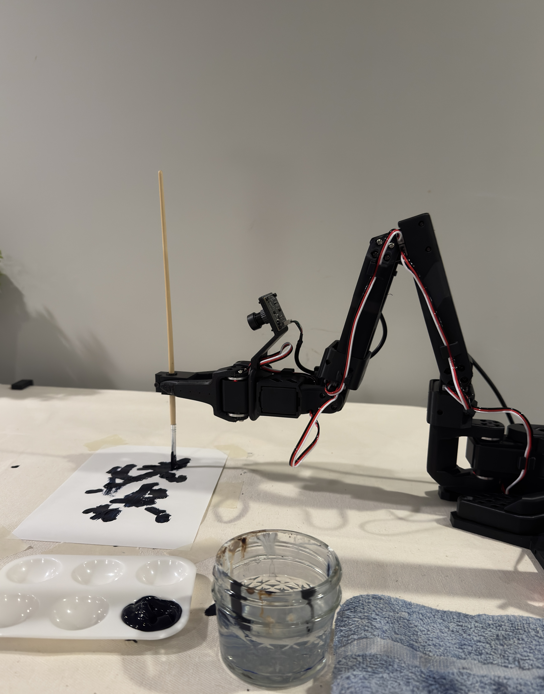
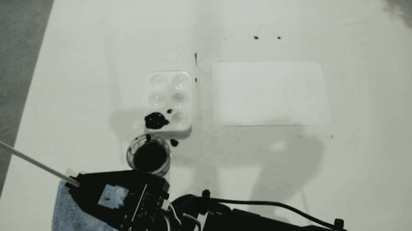
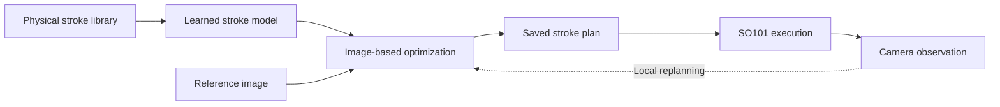

# FRIDA for SO101

**A work-in-progress robotic painter that turns reference images into brushstroke
plans and executes them on an SO101 arm.**

Built on [CMU's FRIDA](https://github.com/cmubig/Frida), this fork focuses on
bringing learned brushstroke planning to a physical SO101 setup: robot motion,
camera and canvas calibration, paint handling, and repeatable experiments.
Training and image-based planning can run locally or on a Runpod GPU.

<table>
  <tr>
    <td align="center"><a href="docs/media/so101-painting.jpg"></a></td>
    <td align="center"></td>
  </tr>
  <tr>
    <td align="center">Physical painting setup</td>
    <td align="center">Painting in progress · 20× playback · 12-second excerpt</td>
  </tr>
</table>

The media shows an early monochrome painting run. Physical painting quality and
repeatability are still being evaluated.

**Stack:** Python · PyTorch · OpenCV · LeRobot · RoboPlan · Pinocchio · Docker · Runpod

[Setup and operation](docs/usage.md) · [Robot calibration](src/SO101/README.md) ·
[GPU workflow](docs/runpod.md) · [Experiment results](docs/runpod-validation.md)

## What this fork adds

FRIDA provides the learned brushstroke model and differentiable painting
optimization. The engineering work in this fork connects that pipeline to the
SO101 and supports experimentation on real hardware.

| Area | Implementation |
| --- | --- |
| **Robot motion** | SO101/LeRobot integration, brush-tip inverse kinematics, calibrated joint limits, collision and brush-tilt checks, and quintic trajectory timing. See [motion planning](src/motion_planner.py) and [execution](src/robot.py). |
| **Physical calibration** | Camera-to-canvas mapping, brush geometry and joint offsets, and a nine-point canvas contact-height grid with interpolated compensation. See [robot setup](src/SO101/README.md) and [height calibration](src/canvas_z.py). |
| **Resumable execution** | Saved stroke plans with atomic checkpoints and setup/model fingerprints checked before connecting to hardware. See [stroke plans](src/stroke_plan.py). |
| **GPU training and planning** | Dockerized Runpod workers, versioned source and model bundles, artifact verification, and local download of plans for robot execution. See [remote workflow](docs/runpod.md). |
| **Experiment tooling** | Paint loading, washing, and repeatability experiments; overhead video and timestamped stroke events for inspection. See [scripts](scripts/) and [camera recording](src/camera/recording.py). |

## How it works

1. **Calibrate and collect:** map the camera and canvas to the robot, then paint
   and photograph a library of physical brushstrokes.
2. **Learn and plan:** train FRIDA's stroke model, then optimize a sequence of
   strokes against a reference image using pixel or CLIP image objectives.
3. **Execute and observe:** validate the saved plan against the physical setup,
   move the brush through the planned strokes, and record the session. Local
   painting can observe the canvas and replan between batches.



Remote jobs train models or produce plans; physical data collection and robot
execution stay local. Simulation uses an in-memory canvas and does not open
hardware, but still needs a matching saved stroke library and trained model.

## Current status and next steps

- **Working prototype:** physical brushstroke execution, calibration tools,
  stroke-library collection, model training, image-based planning, saved-plan
  resumption, and session recording are implemented.
- **Evaluation:** [documented GPU experiments](docs/runpod-validation.md) compare
  objectives, stroke counts, planning times, and rendered-image metrics. Those
  measurements describe simulated plans, not physical painting accuracy.
- **Current limitations:** painting quality depends on the brush, paint loading,
  and calibration. Setup currently relies on an existing `frida-lerobot`
  environment; the inherited dependency files are not a complete fresh-install
  recipe for the SO101 stack.
- **Next milestones:** publish reference/plan/physical-result comparisons,
  quantify physical stroke repeatability, and document a reproducible setup.

## Running the project

Start with the [setup and operation guide](docs/usage.md) for prerequisites,
materials and cache selection, simulation, and saved-plan execution. For a new
physical setup, follow the [SO101 calibration guide](src/SO101/README.md).

For GPU training or planning, use the separate [Runpod workflow](docs/runpod.md).
The repository also contains [regression tests](tests/) for motion planning,
coordinate transforms, calibration, plan persistence, rendering, and remote
artifacts. Run them from the repository root in the configured environment:

```sh
python -m pytest -q
```

## Repository layout

```text
src/             Painting, rendering, optimization, and robot code
  camera/        Capture, calibration, simulation, and recording
  SO101/         Robot models, meshes, offsets, and calibration guide
  caches/        Calibration data, stroke libraries, and trained models
  remote/        Runpod client, worker, and Docker build
scripts/         Calibration, diagnostics, and physical experiments
tests/           Regression tests
targets/         Reference images and palettes
outputs/         Local captures, recordings, and experiment results
docs/            Operating guides, validation history, and demo media
```

## Attribution

FRIDA (a Framework and Robotics Initiative for Developing Arts) was developed at
The Robotics Institute, Carnegie Mellon University, and maintained upstream by
Peter Schaldenbrand. See [FRIDA: A Collaborative Robot Painter with a
Differentiable, Real2Sim2Real Simulated Planning Environment](https://arxiv.org/abs/2210.00664)
for the original research and [the upstream repository](https://github.com/cmubig/Frida)
for its broader research history. This checkout supports the workflows described
above.

Upstream contributors acknowledged by the project include Sunyu Wang, Jia Chen
Xu, Heera Sekhr, Jesse Ding, Vihaan Misra, Tanmay Shankar, and Kevin Zhang.
See [LICENSE](LICENSE) for licensing terms.
